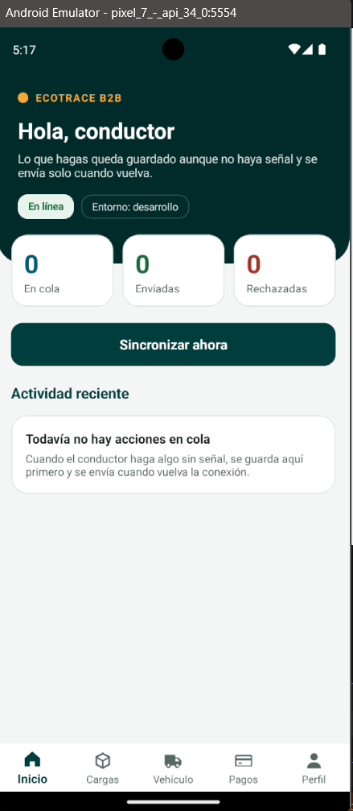
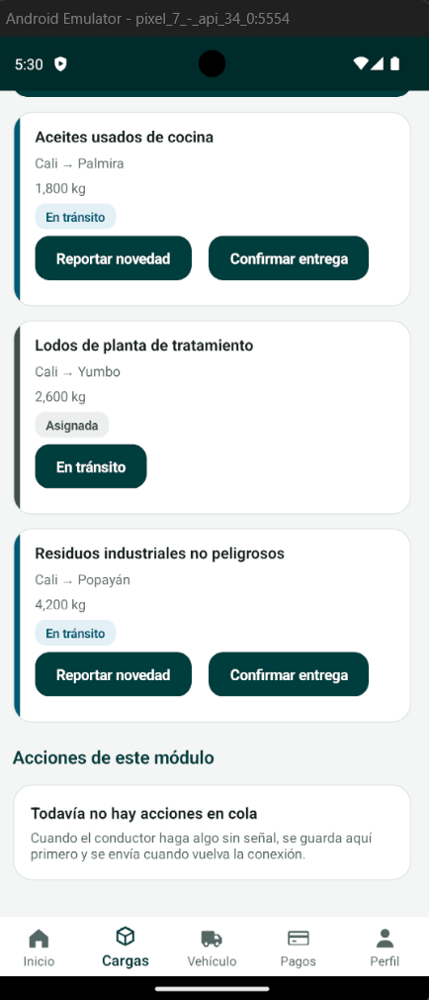
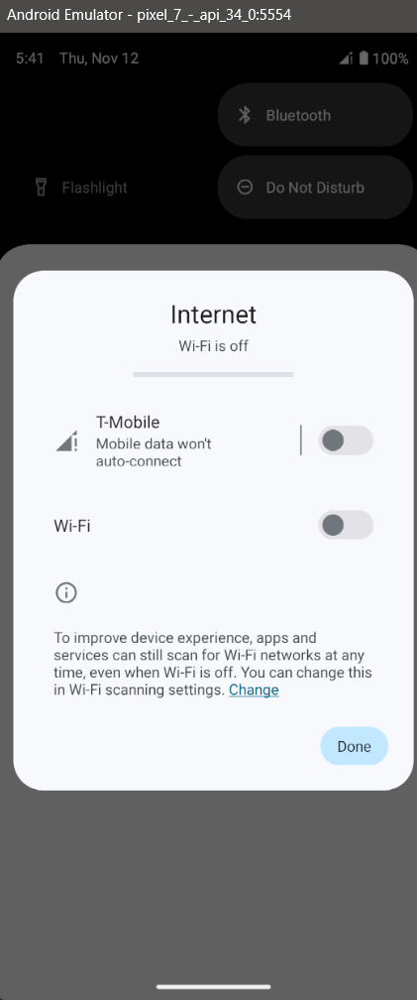
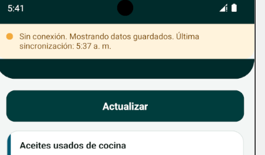
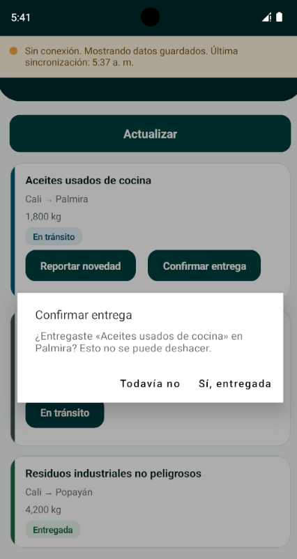
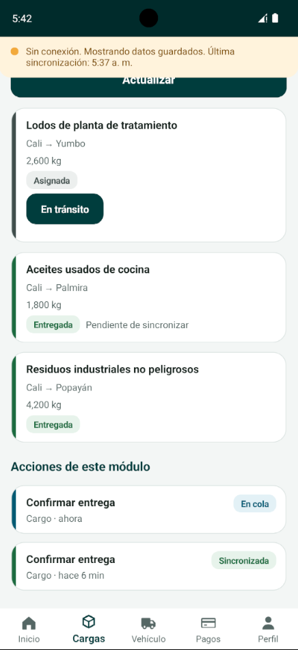
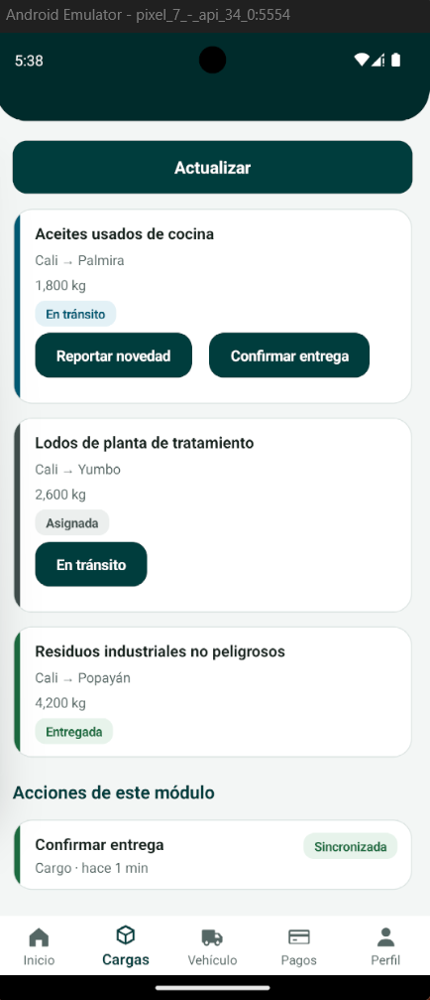
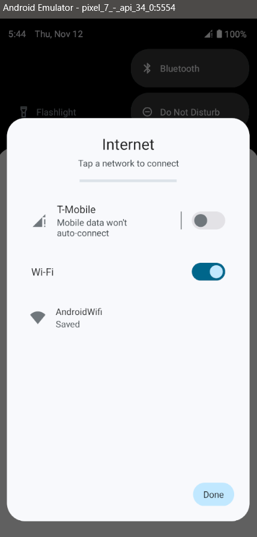
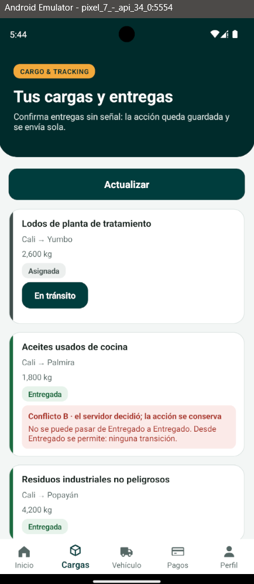
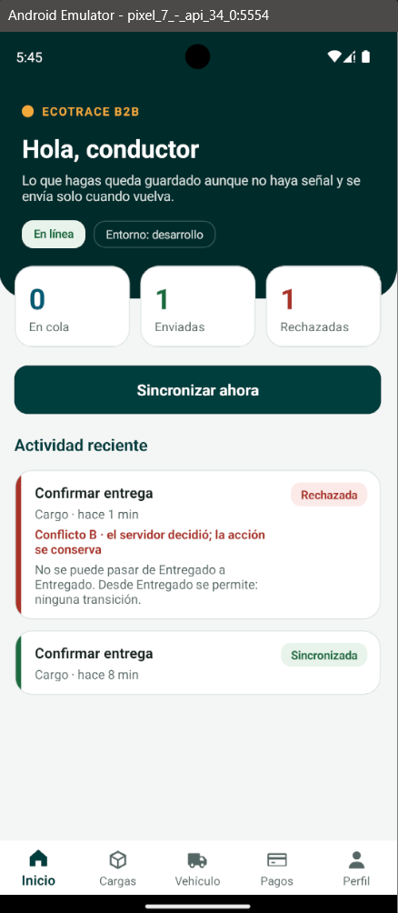

# Checklist de release: Cargo & Tracking

Resultados actualizados el 12 de noviembre de 2026. Este checklist sigue el [ADR 0006](../../../docs/adr/0006-despliegue-smartphones.md) y la
[especificación del Trabajo 3](../trabajo-03/especificacion.md). Dice qué pasos bloquean el release, cómo se comprueba cada uno y
qué resultado hubo. **Un paso solo figura como «Cumple» si se comprobó de verdad.** Lo que depende del emulador, de la firma del
APK o del pipeline de GitHub figura como «Pendiente».

**Acción encolada del módulo:** `Confirmar entrega` (`POST /api/cargas/{id}/seguimientos` con estado `Entregado`). Es una acción
**crítica**: de ahí arranca el Saga que libera el pago.
**Conflicto del módulo:** `B`, la carga ya cambió de estado en el servidor (por ejemplo, otra persona ya la entregó). En Cargo no
existe una ruta para reasignar una carga, así que no se usa la reasignación como ejemplo.

## Cómo se comprobó

| | |
|---|---|
| Build | `dotnet build EcoTrace.sln --configuration Release`: **0 advertencias, 0 errores** |
| Pruebas | `dotnet test EcoTrace.sln --configuration Release`: **133** del móvil y **136** del servidor, todas en verde |
| Servicio | En memoria, con las pruebas de integración, y además en la máquina de desarrollo con los servicios reales (Identity, Fleet, Cargo y Billing) levantados juntos. **No** se levantó la producción simulada en otros puertos. |
| Dispositivo | Emulador Pixel 7 con Android 14 (API 34) y el build de **Debug**, contra los servicios reales. La demo se hizo en una rama local de integración que junta este trabajo con el de Identity (la sesión real de la app y la emisión de tokens). **No** se probó con el build de Release ni en un teléfono físico. |

## Verificación en dos capas

### Capa 1: configuración

| # | Paso | Bloquea | Cómo se comprueba | Resultado |
|---|---|---|---|---|
| 1 | El emisor de producción es distinto al de desarrollo | Sí | `El_emisor_de_produccion_es_distinto_al_de_desarrollo_en_la_configuracion` | Cumple |
| 2 | La configuración común y la de producción no llevan secretos | Sí | `La_configuracion_comun_y_la_de_produccion_no_llevan_secretos` | Cumple |
| 3 | El build de Release del servidor compila sin advertencias | Sí | `dotnet build ... --configuration Release` | Cumple |
| 4 | En producción no se expone Swagger | No | `En_produccion_no_se_expone_la_documentacion_interactiva` | Cumple |
| 5 | El build de Release de la app incrusta la configuración de producción y sus direcciones no son las de desarrollo | Sí | Compilar la app en Release y revisar `appsettings.Produccion.json` | **Pendiente** (hace falta el workload de MAUI) |
| 6 | El APK de Release está firmado con una clave distinta de la de Debug y no es depurable | Sí | `apksigner verify --print-certs` sobre el APK | **Pendiente** (firma del release, compartida con los otros escuadrones) |

### Capa 2: comportamiento real

| # | Paso | Bloquea | Cómo se comprueba | Resultado |
|---|---|---|---|---|
| 7 | El servicio responde `GET /api/_meta/entorno` con su entorno y el emisor que reconoce | Sí | `El_servicio_dice_en_que_entorno_corre_sin_pedir_token` y `En_produccion_el_servicio_se_anuncia_como_produccion` | Cumple (servicio en memoria) |
| 8 | Cargo en producción acepta un token del emisor de producción y rechaza con 401 uno del emisor de desarrollo | Sí | `Cargo_en_produccion_acepta_el_emisor_de_produccion_y_rechaza_el_de_desarrollo` y `Un_token_de_otro_entorno_responde_401` | Cumple (con un Identity de mentira) |
| 9 | Un registro conocido de producción, con identificador fijo, existe en producción y no en desarrollo | Sí | Levantar la producción simulada y consultar el registro | **Pendiente.** Cargo no siembra ninguna carga conocida, y esta comprobación necesita la producción simulada (otros puertos, otra clave) que levanta el script compartido. |
| 10 | Un token **real** de desarrollo, emitido por el Identity de los compañeros, recibe 401 en producción | Sí | Con el Identity real corriendo | **Pendiente** para producción (necesita la producción simulada). En desarrollo sí se comprobó con el Identity real: Cargo acepta sus tokens, y Billing recibió el aviso de entrega con el token de servicio de Cargo (respondió 202). |

## Prueba mínima en emulador o teléfono

La lógica de cada paso está probada con pruebas automáticas, que corren sin dispositivo. La última columna dice además qué se vio en el emulador (Pixel 7, Android 14, build de Debug). Las capturas están en [`evidencia/`](evidencia/). La prueba con el build de Release sigue pendiente.

| # | Paso | Bloquea | Prueba automática de la lógica | En el dispositivo |
|---|---|---|---|---|
| 11 | Modo avión: la lista carga desde SQLite y no queda en blanco | Sí | `Sin_conexion_se_muestra_lo_guardado_y_no_se_llama_al_servidor` | **Cumple** (capturas 04 y 05): sin conexión, la app muestra el aviso «Mostrando datos guardados» y la lista sigue visible. |
| 12 | `Confirmar entrega` sin conexión queda `PendienteSync` y sobrevive a cerrar y abrir la app | Sí | `Una_accion_en_cola_cambia_el_estado_que_se_muestra_de_inmediato_y_queda_pendiente`, `La_copia_sobrevive_a_cerrar_y_abrir_la_app` | **Parcial.** La acción quedó «Pendiente de sincronizar» y en cola (capturas 06 y 07). Falta probar que sobrevive a cerrar y abrir la app. |
| 13 | Al reconectar, sincroniza sola y pasa a `Sincronizado` | Sí | `Una_entrega_sin_conexion_se_envia_al_volver_la_senal_y_pasa_a_Sincronizado` | **Cumple** (capturas 03 y 08): al volver la conexión, la app envió la acción sola, el servidor respondió 201 y la acción pasó a «Sincronizada». |
| 14 | **No duplicación:** reenviar con la misma clave no repite el efecto y el Saga no se dispara dos veces | Sí | `Reintentar_con_la_misma_clave_responde_200...`, `El_reintento_no_dispara_el_Saga_de_pago_dos_veces`, `Reintentos_simultaneos_con_la_misma_clave...`, `Un_corte_a_mitad_del_envio_se_reintenta_con_la_misma_clave...` | **Parcial.** En el servidor real, repetir la entrega con el mismo número respondió 201 y luego 200, dejó una sola entrega y un solo aviso a Billing (comprobado con una llamada repetida desde un script de la demo). Falta provocar el reintento desde la propia app. |
| 15 | Un rechazo del servidor pasa a `Rechazado` con su motivo y se conserva | Sí | `Un_conflicto_B_deja_la_accion_rechazada_con_su_motivo_y_la_pantalla_lo_muestra` | **Cumple** (capturas 09 y 10): la entrega que el servidor ya tenía hecha por otro lado quedó «Rechazada» con su motivo, y los contadores mostraron 1 rechazada. |
| 16 | Con la sesión degradada (token vencido, sin conexión), la acción crítica **no** se encola | Sí | Ninguna | **No implementado.** Ver «Lo que falta». |
| 17 | Los registros del servidor no llevan contraseñas, tokens ni datos personales, y tienen el esquema mínimo | Sí | `Cada_solicitud_deja_un_registro_con_el_esquema_minimo`, `Los_rechazos_se_registran_con_su_codigo_final`, `Ni_el_token_ni_la_clave_ni_la_nota_llegan_al_registro` | Cumple en el servidor. La app no escribe registros con este esquema. |

## Pipeline y firma

| # | Paso | Bloquea | Resultado |
|---|---|---|---|
| 18 | Flujo de GitHub Actions `app-release.yml` que compila en Release, corre las pruebas del Mobile.Core y ejecuta el script de verificación | Sí | **Pendiente** (compartido con los otros escuadrones) |
| 19 | Script `scripts/verificar-release.ps1` con las dos capas, que termina con código distinto de cero si falla un paso que bloquea | Sí | **Pendiente** (compartido con los otros escuadrones) |

## Gate

Bloquean el release todos los pasos marcados «Sí». **Hoy el release no se aprueba:** los pasos 5, 6, 9, 10, 16, 18 y 19 están
pendientes o sin implementar, y los pasos 12 y 14 están cumplidos solo en parte. Cumplen los pasos 1, 2, 3, 7, 8, 11, 13, 15 y 17.

Si la app apuntara por error a desarrollo, la pantalla funcionaría igual. Por eso el paso 7 le pregunta al servicio en qué entorno
corre, el paso 8 comprueba que rechaza los tokens del otro entorno, y los pasos 9 y 10 lo confirmarían contra producción de verdad.

## Evidencia del emulador

Las capturas son del emulador Pixel 7 con Android 14 y el build de Debug. Conviene mirarlas en este orden.

**La app con sesión iniciada y la entrega sin conexión (pasos 11, 12 y 13)**

| Captura | Qué muestra |
|---|---|
|  | Pantalla de inicio con los contadores en cero. |
|  | Las tres cargas del conductor, traídas del servidor con su token. |
|  | El teléfono sin Wi-Fi ni datos móviles. |
|  | La app avisa «Sin conexión. Mostrando datos guardados» y la hora de la última sincronización. |
|  | Pide confirmar la entrega, porque no se puede deshacer. |
|  | La carga cambia al instante a «Entregada», marcada «Pendiente de sincronizar», y la acción queda en cola. |
|  | Con la conexión de vuelta, la acción pasa a «Sincronizada». |

**El conflicto B (pasos 13 y 15)**

| Captura | Qué muestra |
|---|---|
|  | Se vuelve a activar el Wi-Fi, después de que el servidor ya había registrado la entrega por otro lado. |
|  | El servidor rechaza la acción y la tarjeta muestra el motivo: no se puede pasar de Entregado a Entregado. |
|  | Los contadores de Inicio: 1 enviada y 1 rechazada. |

## Integración con los otros escuadrones

- La demo usó la sesión real de Identity: la app inició sesión, Cargo validó el token con la clave pública de Identity y Cargo
  consiguió su token de servicio (Identity registró «Token de servicio emitido para cargo hacia ecotrace-billing»).
- Billing recibió el aviso de entrega y lo aceptó (202).
- Después, la Saga de Billing terminó «Fallida»: llamó a Identity sin token de servicio y Identity respondió 401. En la rama que se
  usó, Billing todavía es la versión anterior, que no manda token. La rama de Billing (`feature/billing#25`) ya incluye el manejo
  del token de servicio, así que ese paso depende de que entre su PR.

## Evidencia de no duplicación

- La tabla `OperacionesProcesadas` guarda cada `OperationId` ya procesado, junto con la respuesta que se dio.
- El primer envío responde `201` y un reintento con la misma clave responde `200` con el resultado anterior.
- Tras el reintento sigue habiendo un solo seguimiento `Entregado`, un solo mensaje en el Outbox y un solo Saga de pago
  (`El_reintento_no_dispara_el_Saga_de_pago_dos_veces`).
- Seis reintentos simultáneos dejan una sola entrega (`Reintentos_simultaneos_con_la_misma_clave_dejan_una_sola_entrega_y_un_solo_mensaje`).
- Quien no es de la organización transportista no recibe el resultado guardado aunque conozca la clave
  (`Repetir_una_entrega_con_la_misma_clave_solo_se_le_responde_a_la_organizacion_de_la_carga`).

## Lo que falta

- **Sesión degradada (paso 16).** La especificación dice que, con la sesión degradada, la app no permite acciones que muevan dinero
  ni cierren un ciclo de negocio crítico, y confirmar una entrega es una de ellas. El módulo de Cargo todavía no lo comprueba:
  `IProveedorDeSesion` solo entrega el token y no dice si la sesión es degradada. Hace falta que el módulo de Identity exponga ese
  estado, y que Cargo rechace `ConfirmarEntrega` cuando la sesión esté degradada.
- **Probar con el build de Release** los pasos 11 a 15, y probar que una acción pendiente sobrevive a cerrar y abrir la app (paso 12).
- **Provocar un reintento desde la propia app** (paso 14), por ejemplo cortando la conexión justo mientras envía.
- **La producción simulada** (pasos 9 y 10), con otro juego de servicios, otros puertos y otra clave de firma.
- **La cadena hasta el pago liberado**, que necesita que entren los PR de Billing y Fleet.
- **El pipeline, el script de verificación y la firma del APK** (pasos 6, 18 y 19), que comparten los cuatro escuadrones.
- **La app móvil no escribe registros con el esquema mínimo.** Lo verificado es el servidor.
